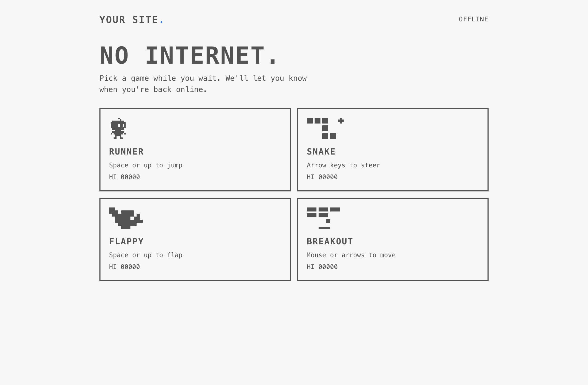
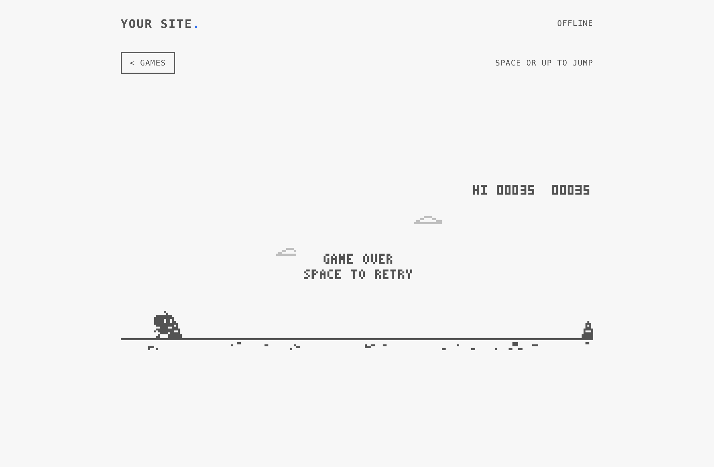
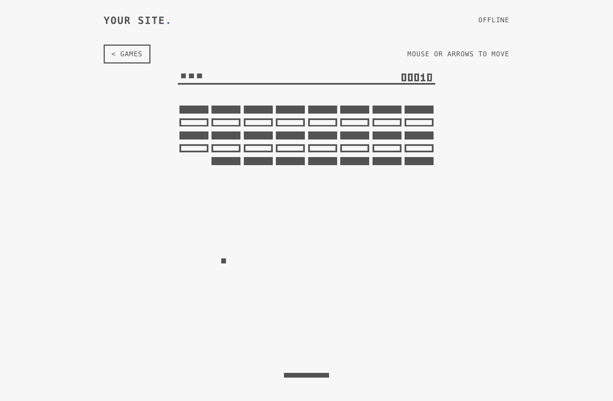
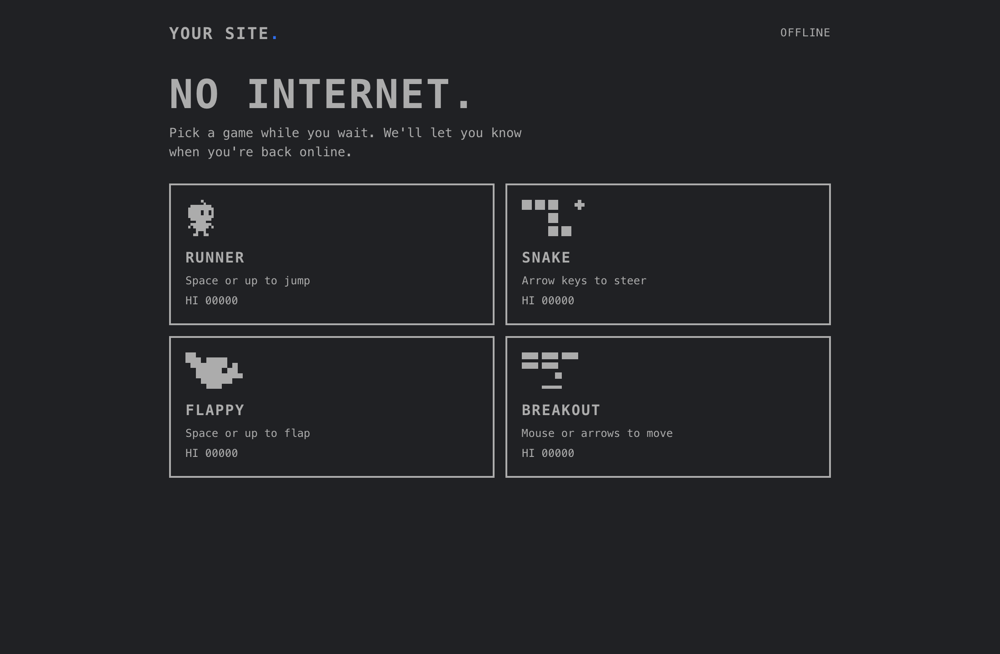

# Offline Arcade

**Give your website its own "Chrome dinosaur".** When a visitor's connection drops, a page fails to load, or a page is taking forever, they get four little pixel games instead of the browser's error screen. When the page is ready they're taken back to it.

It works on any website you can add files to: plain HTML, Next.js, Vite, Astro, WordPress, Rails, you name it. And it's packaged as an **agent skill**, so you can just ask your AI coding agent to add it.



| Runner | Breakout | Dark mode |
|---|---|---|
|  |  |  |

## What visitors get

- **No internet, or the server can't be reached.** Any page of your site shows the arcade instead of the browser's error page. When the connection comes back, a **Continue** button takes them to the page they wanted.
- **A slow page** (still loading after 6 seconds). The games appear while the page keeps loading in the background. An **Open page** button appears when it's ready, and opening it is instant.
- **Connection drops mid-visit.** A small bar offers **Play**.
- **Four games:** Runner (jump the obstacles), Snake, Flappy and Breakout. They work with keyboard, mouse and touch, keep high scores, follow light and dark mode, and work on phones.

### The one limit

It works for anyone who has opened your site **once** while online. On that visit, the browser quietly saves the arcade (about 30 KB). A device that has never loaded your site has nothing from it yet, so the browser shows its own offline page. That's true for every website; only the browser maker controls that screen.

## Add it with an AI agent (recommended)

The folder is an [agent skill](https://docs.claude.com/en/docs/agents-and-tools/agent-skills/overview): `SKILL.md` tells an agent what to do, step by step, and covers frameworks, security headers, sites with both `www.` and a bare domain, and sites that already have a service worker.

**Claude Code**

```bash
git clone https://github.com/jagritchawla2099/offline-arcade ~/.claude/skills/offline-arcade
```

Then, in your project: *"Add the offline arcade to this site."*

**Other agents** (Cursor, Codex, Copilot, Windsurf, Gemini CLI, ...): clone the repo anywhere and tell the agent:

> Follow the instructions in `path/to/offline-arcade/SKILL.md` to add the offline arcade to this site.

The agent will copy the files, match your colours and name, keep the games away from login, checkout and admin pages, check your security headers, and test the result.

## Add it by hand

1. Copy `assets/arcade.js`, `assets/arcade-sw.js` and `assets/arcade-offline.html` into the folder your site serves at `/` (`public/`, `static/`, or next to `index.html`). They must load from the root, e.g. `https://example.com/arcade-sw.js`.
2. Add this to the `<head>` of every page:
   ```html
   <script src="/arcade.js" async></script>
   ```
3. In `arcade-offline.html`, change the name in `.logo`, the colours in `:root` and the text in `COPY`. Everything is marked `CUSTOMIZE`.
4. In `arcade-sw.js`, add your sign-in, account, admin, API and checkout paths to `SKIP_PATHS`.
5. Deploy over HTTPS, open the site once, then go offline (DevTools → Network → Offline) and reload.

`references/frameworks.md` lists where the files and the script tag go in each framework. If your site answers on both `www.example.com` and `example.com`, read `references/twin-domain.md`. Otherwise people who type the other address while offline still get the browser's page.

## Test it

```bash
npm i --no-save puppeteer
node scripts/verify.mjs https://www.example.com
node scripts/verify.mjs https://www.example.com --twin https://example.com
```

It opens your site in a headless Chrome, cuts the connection, and checks the offline bar, a fresh tab opened offline, the twin address, the back-online notice, and that normal pages are untouched.

To try a production build on `localhost`, run `localStorage.setItem("arcade-dev", "1")` in the console first. The arcade stays off on localhost by default, so it doesn't interfere with your dev server or follow you to other projects on the same port.

## How it works

`arcade.js` installs a small [service worker](https://developer.mozilla.org/en-US/docs/Web/API/Service_Worker_API) (`arcade-sw.js`), which caches the games page.

For every page load, the worker races the network against a 6-second timer:
- **Network error:** it serves the games.
- **Too slow:** it serves the games, keeps loading the real page in the background, and keeps the finished page for up to 10 minutes, so **Open page** is instant.

It never stores pages marked `private` or `no-store`. The paths you skip (sign-in, checkout, account areas) are never swapped for games while they're slow; they only get the games when the network is completely down. The games page is a single self-contained file with its own strict security policy and no external requests.

Details for the curious, or for debugging, are in [SKILL.md](SKILL.md#how-it-works-for-debugging).

## Settings

| Where | Setting | Default |
|---|---|---|
| `arcade-sw.js` | `SLOW_MS`: when slow pages switch to the games (`0` = offline only) | `6000` |
| `arcade-sw.js` | `SKIP_PATHS`: never swapped while slow, never stored | login, auth, account, dashboard, admin, API, cart, checkout |
| `arcade-sw.js` | `VERSION`: bump after editing the games page | `"v1"` |
| `arcade.js` | `MESSAGE`, `BUTTON`, `BAR_BG`, `BAR_TEXT`, `ACCENT`, `ACCENT_TEXT`: the offline bar | English, dark bar, blue button |
| `arcade.js` | `TWIN_ORIGIN`: your other address (www or bare) | off |
| `arcade-offline.html` | name, colours, text | marked `CUSTOMIZE` |

## Browser support

Any browser with service workers: Chrome, Edge, Firefox, Safari (desktop and iOS), Brave, Samsung Internet. Tested end to end in Chrome and Brave. In browsers without service workers, nothing happens and nothing breaks.

## Removing it

Delete the script tag. Visitors' browsers keep a service worker until it tells them otherwise, so for a few weeks replace `arcade-sw.js` with the "remove" snippet in [SKILL.md](SKILL.md#updating-and-removing).

## License

MIT. See [LICENSE](LICENSE). Built by [Marktech Studios](https://www.marktechstudios.com).
